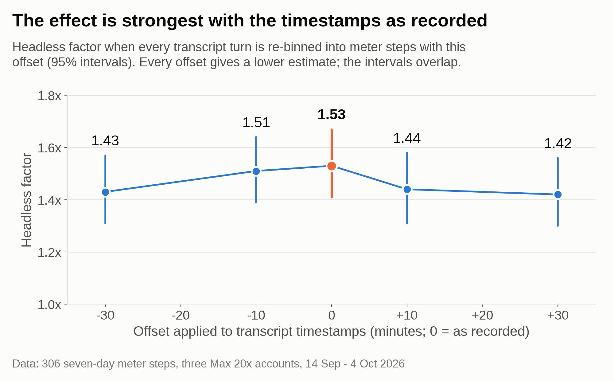
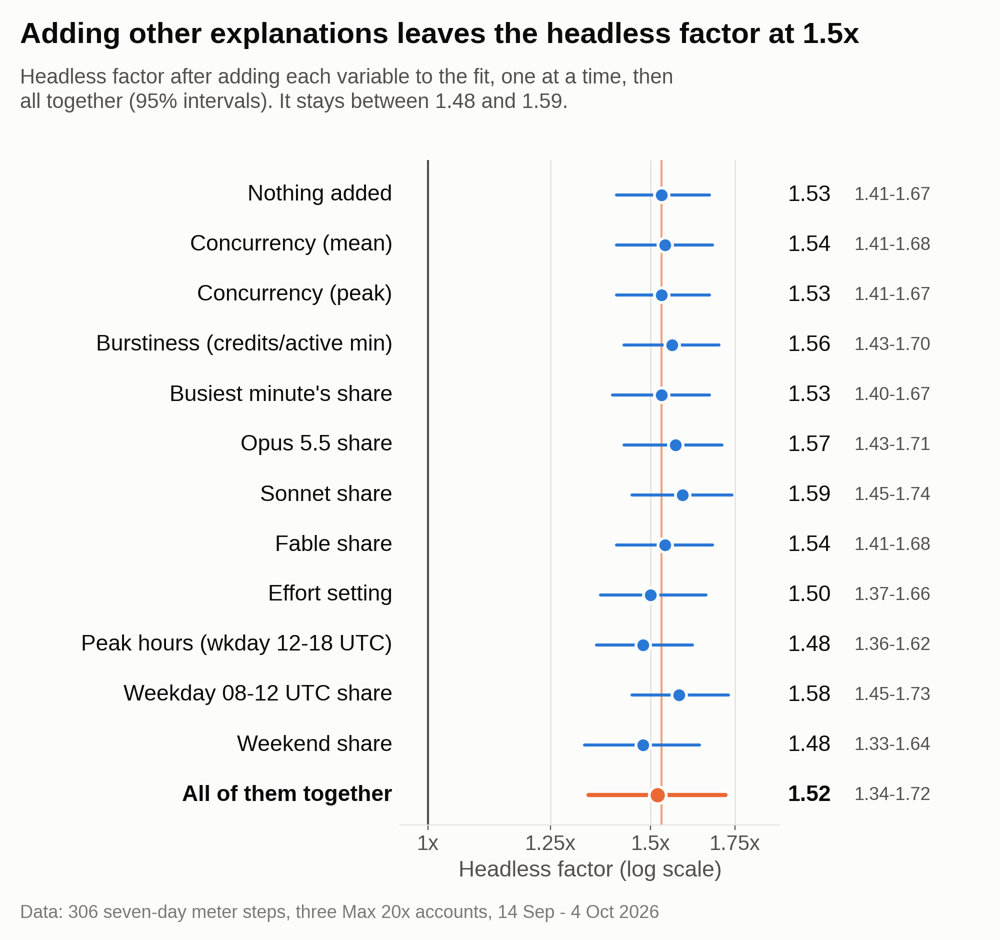

# Headless `claude -p` runs and the five-hour limit

**Summary.** For each 1% of the seven-day (weekly) meter, headless `claude -p` work moved the five-hour meter **1.53x** as far as interactive Claude Code work (95% CI 1.41 to 1.67), across 306 meter steps on three Max 20x accounts from 14 Sep to 4 Oct 2026.
At the tracker's token valuation (302 clean steps, [section 6](#6-which-meter-carries-it)), headless moved the five-hour meter 1.63x [1.36, 1.95] as far per credit and the seven-day meter 1.05x [0.93, 1.18] as far. Under other valuations these run about 1.3 to 2.1 and 0.83 to 1.37. At the weights the meters prefer, the seven-day figure is 1.14 to 1.21; the 1.53 ratio barely moves.
Every explanation tested (cache TTL, per-run overhead, timing, concurrency, model mix, effort, sub-agents, window resets) leaves the factor between 1.39 and 1.59.

This page holds the full evidence. The data, scripts and commands are described in [REPRODUCE.md](REPRODUCE.md) in this folder.

## Contents

1. [How it was measured](#1-how-it-was-measured)
2. [Main result](#2-main-result)
3. [Per account](#3-per-account)
4. [Ruled out](#4-ruled-out)
5. [Robustness](#5-robustness)
6. [Which meter carries it](#6-which-meter-carries-it)
7. [Limitations](#7-limitations)
8. [How to reproduce](#8-how-to-reproduce)
9. [Findings docs](#9-findings-docs)

## 1. How it was measured

### Data

| item | value |
|---|---|
| accounts | three Max 20x accounts, called Max accounts 2, 3 and 4. All Claude Code, all run from one machine whose transcripts the analysis reads |
| fourth account | Max account 1 has no transcripts on that machine. It appears only in the four-account fit in [section 3](#3-per-account) |
| window | 14 Sep 2026 12:00Z to 4 Oct 2026 19:53Z (the last cached transcript message) |
| steps | 306 (Max account 2: 137, Max account 3: 128, Max account 4: 41) |
| assistant messages with usage data | 143,406 |
| headless-heavy steps (over 80% headless) | 58, of which Max account 3 has 50 |
| meters | five-hour and seven-day utilization as each account's usage API reports it, in whole percentages, read a median of 130 seconds apart |
| cap | no five-hour window the tracker recorded between 14 Sep and 11 Oct reached 100% on these three accounts. Their peaks were 55%, 71% and 95% |

**Plan check.** The repo records all four accounts as Max 20x. Over 14 Sep to 11 Oct, across all steps, the meters read 4.41 (Max account 2), 4.57 (Max account 4) and 4.73 (Max account 1) five-hour points per seven-day point. Max account 3 is left out because its headless work raises its ratio. A Max 5x account would read about 1.67 times as many (the repo's credits-table ratio). That shows the accounts are consistent with one plan and with one another. Billing data was not checked.

**Headless runs drew on the subscription.** Anthropic's [support article](https://support.claude.com/en/articles/15036540) says: "Update June 15, 2026: We've paused the previously-announced changes to Claude Agent SDK usage. For now, nothing has changed: Claude Agent SDK, `claude -p`, and third-party app usage still draw from your subscription limits." The headless-heavy steps moved both meters, which fits that. On 7 Oct, Max plans gained monthly API credits that cover `claude -p`. The main window ends before that change; the check to 11 Oct spans it.

### Definitions

- **Step:** an account's seven-day meter rising one whole point. Steps tile the timeline with no gaps and no overlaps, so every step has exactly one seven-day point.
- **Five-hour points:** the five-hour meter's one-point rises inside the step, including the points of a new five-hour window.
- **Work:** every assistant message with token usage in the account's Claude Code transcripts. A message belongs to the step its timestamp falls in.
- **Headless:** a main-session transcript whose first lines record `entrypoint: sdk-cli`, which is a `claude -p` run. Sub-agent transcripts never count as headless, even when a headless run spawns them.
- **Interactive:** everything that is not headless: interactive main sessions plus all sub-agents. In steps under 0.2 headless, on average 63% of each step's credits are sub-agent work and 35% interactive main sessions. In headless-heavy steps the average is 1% sub-agent. [Section 4e](#4e-request-counts-sub-agents-and-window-resets) separates the two.
- **Headless share:** the step's headless credits over all its credits. Credits are tokens valued at list-price ratios between models, with output at 5x input and cache writes of both TTLs at 1x input. The headline run counts cache reads at 0.00398 of an Opus input credit; the covariate run leaves them out. Both give 1.53 [1.41, 1.67].
- **Model:** a quasi-Poisson regression (log link) of five-hour points per step, with terms for period, account and headless share. The headless factor is exp(coefficient), going from share 0 to share 1. The 95% interval is exp(b ± 1.96·se), with se scaled by the Pearson dispersion.
- **Periods:** each period gets its own baseline. Boundaries are 14 Sep 12:00Z (Anthropic's announced weekly limit change, which the tracker never certified), 22 Sep 19:41Z (the first Opus 5.5 turn; the section 6 fits show both limits rising then, x1.16 credits per seven-day point and x1.20 per five-hour point) and 29 Sep 18:25Z (the first Sonnet 5.5 use). The tracker treats each new model family's first use as a possible change point. Dropping the period terms gives 1.53 [1.42, 1.65] ([section 5](#5-robustness)).

The result compares one meter reading with the other. Token pricing enters only through the headless share, and the factor stays between 1.52 and 1.54 under every token valuation tried (1.49 to 1.52 in the check to 11 Oct). If headless runs spent tokens the transcripts never record (system prompt, tool definitions, retries), both meters would see that spend, so hidden tokens could only produce the factor if the two meters weighed them differently.

## 2. Main result

**Headless factor: 1.53x [1.41, 1.67]**, 306 steps.


*Figure 1. Five-hour points per seven-day point against headless share; the fitted curve (period and account terms) rises from 4.4 to 6.8.*

Plain means, no model (95% bootstrap within each bin). The share here leaves cache reads out, as the covariate run does; on that share 57 steps are over 0.8 headless.

| headless share | steps | five-hour points per seven-day point |
|---|---:|---|
| 0 to 0.15 | 215 | 4.40 [4.26, 4.55] |
| 0.15 to 0.5 | 22 | 5.50 [5.00, 6.00] |
| 0.5 to 0.9 | 15 | 6.00 [5.27, 6.87] |
| 0.9 to 1 | 54 | 7.04 [6.59, 7.50] |

The raw end-to-end ratio is 7.04 / 4.40 = 1.60, with no adjustment for period or account. The fitted 1.53 has both.

## 3. Per account


*Figure 2. Headless factor per account and pooled, 306-step window; every point estimate is above 1x.*

| account | factor [95%] | steps | mean headless share | over 80% headless |
|---|---|---:|---:|---:|
| Max account 2 | 2.22 [1.57, 3.14] | 137 | 0.05 | 0 |
| Max account 3 | 1.49 [1.33, 1.67] | 128 | 0.45 | 50 |
| Max account 4 | 1.52 [0.92, 2.49] | 41 | 0.22 | 8 |
| **pooled** | **1.53 [1.41, 1.67]** | 306 | | 58 |

- **Max account 3 carries most of the evidence:** 50 of the 58 headless-heavy steps.
- **Max account 2 has no step over 80% headless.** Its 2.22 rests on mixed steps only.
- **Max account 4's 8 headless-heavy steps all fall within 40 minutes on 1 Oct,** so its interval includes 1. To 11 Oct it reads 1.08 [0.80, 1.47] ([section 5](#5-robustness)).

### Max account 1 and the four-account fit

The 5 Oct analysis read transcripts on the machine that runs Max accounts 2 to 4. Max account 1's transcripts are on another machine, so it is not in the 306-step fit. It appears only in the tracker's own four-account fit, which uses a different step set: it starts on 5 Sep, uses the tracker's clean steps on all four accounts and values work at fitted model rates. Its per-account figures therefore differ from the table above.

| account | factor [95%] | steps | mean headless share |
|---|---|---:|---:|
| Max account 1 | 2.66 [1.43, 4.93] | 211 | 0.035 |
| Max account 2 | 1.38 [1.26, 1.51] | 273 | 0.254 |
| Max account 3 | 1.50 [1.34, 1.68] | 134 | 0.472 |
| Max account 4 | 1.53 [0.92, 2.51] | 41 | 0.223 |
| **pooled** | **1.486 [1.381, 1.599]** | 659 | |

Max account 1's interval is wide because its mean headless share is 0.035, so little of its data separates headless from interactive work.

## 4. Ruled out

Each of these could produce a false headless effect. Each was tested by adding a term to the model, repricing the work or shifting timestamps, and each leaves the factor at about 1.5.

### 4a. Prompt-cache TTL

Headless and interactive main sessions both write one-hour cache only. Sub-agents write five-minute cache only. Share of credits going to one-hour writes, headless against interactive main sessions:

| account | headless | interactive main sessions |
|---|---:|---:|
| Max account 2 | 0.531 | 0.379 |
| Max account 3 | 0.381 | 0.384 |
| Max account 4 | 0.613 | 0.424 |

Max account 3 shows the effect (1.49x) with near-identical write shares. Sub-agents, 63% of the interactive baseline, write five-minute cache only. Against interactive main sessions alone, whose writes match headless, the factor is 1.46 [1.30, 1.65] ([section 4e](#4e-request-counts-sub-agents-and-window-resets)). Repricing the writes barely moves the factor:

| write pricing | headless factor [95%] |
|---|---|
| writes at 1x input | 1.53 [1.41, 1.67] |
| API ratios (5m 1.25x, 1h 2x, read 0.1x) | 1.52 [1.40, 1.66] |
| one-hour writes at 1.6x | 1.54 [1.41, 1.68] |
| one-hour writes at 2x | 1.54 [1.41, 1.68] |

### 4b. Per-run startup overhead

Hidden spend at the start of each `claude -p` run.

- The 58 headless-heavy steps hold 10.6 runs each, at 98.4k credits per run.
- The first turn's cache write is in the transcripts and is 11.8% of headless credits.
- There is a small real per-run cost. A runs-per-million-credits term reads 1.03 [1.01, 1.06] per standard deviation (8.8 runs per million credits). With it added, headless reads 1.45 [1.32, 1.60].

### 4c. Timing

Work landing in the wrong step. Every turn's timestamp was shifted before assigning it to a step. The factor is highest with the timestamps as recorded; the intervals overlap.



*Figure 3. Headless factor with transcript timestamps shifted before matching them to meter steps; it peaks at 0.*

| shift | factor [95%] |
|---|---|
| −30 min | 1.43 [1.31, 1.57] |
| −10 min | 1.51 [1.39, 1.64] |
| **0 (as recorded)** | **1.53 [1.41, 1.67]** |
| +10 min | 1.44 [1.31, 1.58] |
| +30 min | 1.42 [1.30, 1.56] |

### 4d. Concurrency, model mix, effort and time of day

Each variable was added beside headless share, then all of them together. Continuous variables are per standard deviation; shares run from 0 to 1.



*Figure 4. Headless factor after adding each other variable one at a time, then all together; every estimate is between 1.48 and 1.59.*

| added variable | that variable | headless beside it |
|---|---|---|
| none | | **1.53 [1.41, 1.67]** |
| concurrency, mean (log) | 0.97 [0.94, 1.00] | 1.54 [1.41, 1.68] |
| concurrency, peak (log) | 1.00 [0.97, 1.03] | 1.53 [1.41, 1.67] |
| credits per active minute (log) | 0.95 [0.92, 0.98] | 1.56 [1.43, 1.70] |
| busiest minute's share | 0.95 [0.93, 0.98] | 1.53 [1.40, 1.67] |
| Opus 5.5 share | 0.84 [0.71, 1.01] | 1.57 [1.43, 1.71] |
| Sonnet share | 1.12 [1.00, 1.26] | 1.59 [1.45, 1.74] |
| Fable share | 1.03 [0.89, 1.18] | 1.54 [1.41, 1.68] |
| effort (low 1 to max 5) | 1.01 [0.98, 1.04] | 1.50 [1.37, 1.66] |
| peak hours (weekday 12–18 UTC) share | 1.11 [1.04, 1.18] | 1.48 [1.36, 1.62] |
| weekday 08–12 UTC share | 0.87 [0.79, 0.96] | 1.58 [1.45, 1.73] |
| weekend share | 0.95 [0.87, 1.03] | 1.48 [1.33, 1.64] |
| **all together** (peak concurrency left out) | | **1.52 [1.34, 1.72]** |

- **Concurrency.** Headless sessions do run a little more in parallel. The median step's concurrency is 3.5 against 2.6, and its peak 5 against 4.
- **Effort** reads 1.07x on its own and 1.01 beside headless.
- **Other step features.** Step length leaves headless at 1.54. Turns and sessions are in [section 4e](#4e-request-counts-sub-agents-and-window-resets).
- **Token-class mix.** On the 302 clean steps from [section 6](#6-which-meter-carries-it), shares of output, cache reads and cache writes leave headless at 1.52. Every class coefficient's interval includes 1.
- **Peak hours.** In Sep and Oct, weekday 12–18 UTC is exactly 5–11am PT, the peak-hours window as a third-party blog quotes Anthropic. As [quoted there](https://claudeunleashed.substack.com/p/avoid-claudes-peak-times-to-save): "During weekdays between 5am–11am PT, you'll move through your 5-hour session limits faster … Your weekly limits remain unchanged." That would show up in this data as a five-hour-only effect, and the data shows one. The share reads 1.19 [1.11, 1.27] on its own, 1.11 beside headless, and 1.09 [1.01, 1.18] with everything in. Resampled by whole days, beside headless, it reads 1.11 [1.01, 1.21]. In the window to 11 Oct it reads 1.18 [1.09, 1.27] (day-resampled). Headless stays between 1.42 and 1.52 beside it in every one of these fits.

### 4e. Request counts, sub-agents and window resets

Refitted from the per-step table, 306 steps; continuous variables per standard deviation.

| added variable | that variable | headless beside it |
|---|---|---|
| turns per million credits (log) | 1.02 [0.99, 1.05] | 1.55 [1.42, 1.69] |
| sessions per million credits (log) | 1.02 [0.99, 1.05] | 1.53 [1.41, 1.67] |
| sub-agent share (interactive main sessions as the baseline) | 0.94 [0.84, 1.05] | 1.46 [1.30, 1.65] |
| five-hour window resets in the step | 1.00 [0.97, 1.03] | 1.53 [1.41, 1.67] |
| all of 4d plus runs, sub-agent share and turns | | 1.42 [1.18, 1.71] |

- **Requests and sessions.** Headless-heavy and interactive steps look alike (medians): 317 against 304 turns per million credits, 3.16k against 3.29k credits per turn, and 8.7 against 10.0 sessions per million credits.
- **Sub-agents.** Plain means of five-hour points per seven-day point: steps that are mostly interactive main session (38 steps) read 4.63, mostly sub-agent (91 steps) 4.24, and mostly headless (58 steps) 7.09.
- **Whole-percent rounding and window resets.** Five-hour window resets are equally common in both kinds of step: 0.21 per mostly-headless step against 0.205 per interactive step (57 steps over 0.8 and 224 under 0.2, on the share without cache reads). On the 245 steps with no reset, headless reads 1.53 [1.38, 1.69].
- The rebuild of the ten-variable fit from the per-step table gives 1.53 [1.35, 1.73], against the tool's 1.52 [1.34, 1.72].

## 5. Robustness

| check | headless factor [95%] |
|---|---|
| main fit, 306 steps | 1.53 [1.41, 1.67] |
| day-block bootstrap (19 UTC days, 2,000 resamples) | 1.53 [1.38, 1.69] |
| no period terms | 1.53 [1.42, 1.65] |
| 14 to 22 Sep only, one period (191 steps) | 1.53 [1.38, 1.69] |
| leave out Max account 2 (169 steps) | 1.51 [1.36, 1.68] |
| leave out Max account 3 (178 steps) | 1.50 [1.23, 1.83] |
| leave out Max account 4 (265 steps) | 1.54 [1.41, 1.69] |
| interactive main sessions as the baseline | 1.46 [1.30, 1.65] |
| all covariates together (4d) | 1.52 [1.34, 1.72] |
| headless run count added | 1.45 [1.32, 1.60] |
| everything at once (4e) | 1.42 [1.18, 1.71] |
| four cache-write pricings | 1.52 to 1.54 |
| extended to 11 Oct, 397 steps | 1.49 [1.37, 1.62] |
| extended, day-block bootstrap (26 days) | 1.49 [1.30, 1.65] |
| extended, all covariates | 1.49 [1.34, 1.67] |
| extended, interactive main sessions as the baseline | 1.45 [1.31, 1.61] |
| extended, everything at once | 1.39 [1.20, 1.62] |
| tracker's own fit, 4 accounts, 659 steps | 1.486 [1.381, 1.599] |
| same fit to 11 Oct, 738 steps | 1.484 [1.384, 1.592] |

Across every pooled fit with account terms, the factor runs from 1.39 to 1.59, and no lower bound falls below 1.18.

Per account in the window extended to 11 Oct:

| account | factor [95%] |
|---|---|
| Max account 2 | 1.89 [1.36, 2.63] |
| Max account 3 | 1.50 [1.34, 1.67] |
| Max account 4 | 1.08 [0.80, 1.47] |

Max account 4's five new steps are all interactive, and its headless evidence is still the same 8 steps from 1 Oct.

Two steps in the extended window are unexplained. On 7 Oct, two Max account 2 steps moved the seven-day meter a full point on about 7k credits of recorded work. Both are in the 397-step fit.

## 6. Which meter carries it

The 1.5x is a ratio of two meters. To see which one moves, each meter was fitted against credits of work, with the same rows and terms. The data is the tracker's clean steps from its public history (302 steps in the main window, 386 to 11 Oct). They leave out harness runs and cloud-session steps.


*Figure 5. Meter points per credit of work, headless against interactive; the check to 11 Oct is in grey.*

| headless vs interactive | to 4 Oct (302 steps) | to 11 Oct (386 steps) |
|---|---|---|
| ratio (5h per 7d point) | 1.537 [1.408, 1.678] | 1.512 [1.390, 1.645] |
| (a) five-hour per credit | **1.628 [1.356, 1.953]** | 1.541 [1.295, 1.835] |
| (b) seven-day per credit | **1.049 [0.930, 1.184]** | 0.998 [0.895, 1.112] |
| (a) / (b) | 1.551 (+0.9%) | 1.545 (+2.2%) |

(a)/(b) matches the ratio. The fits share rows, so this is a consistency check, not independent proof.

**Without a model.** Max account 3, 18 to 21 Sep: one account, one period, the same days.

| | steps | credits per 7d point | credits per 5h point | 5h per 7d point |
|---|---:|---:|---:|---:|
| interactive (share under 0.2) | 64 | 1,214k | 253k | 4.80 |
| headless (share over 0.8) | 19 | 1,093k | 148k | 7.37 |

Per credit, headless moved the seven-day meter 1.11x as far and the five-hour meter 1.71x as far.

**A correction to the 5 Oct docs.** The five-hour findings doc used a crude bucket comparison, with no period or account terms, that made headless look cheaper per credit on the seven-day meter. That was a mix effect. Both limits rose around 22 Sep; 38 of the 58 headless-heavy steps fall after that date, and 156 of the 224 interactive steps fall before it. The limit increase was being read as a headless discount. Within 14 to 22 Sep alone, the seven-day factor is 0.99. The figures in the table above replace that comparison.

**How much the split depends on token prices.** The ratio barely does: 1.52 to 1.54 under every valuation tried (1.49 to 1.52 in the check to 11 Oct). (a) and (b) do, and they move together:

| token weights | (a) five-hour | (b) seven-day |
|---|---:|---:|
| cache reads at 0 | 1.43 | 0.91 |
| cache reads at 0.01 | 1.59 | 1.02 |
| cache reads at 0.03 | 1.79 | 1.16 |
| cache reads at 0.1 | 2.09 | 1.37 |
| one-hour writes at 2x | 1.30 | 0.83 |
| API ratios | 1.92 | 1.25 |

The meters' own data reject the weights that push (b) below 1 (cache reads at 0, or one-hour writes at 2x with everything else fixed). The weights the data prefer give (a) about 1.76 to 1.87 and (b) about 1.14 to 1.21.

**Confidence.**

- **High that headless costs more on the five-hour meter.** Among fits that can identify it, its factor is about 1.3 to 2.2 under every method, apart from weightings the data reject. Fits that cannot identify it: leaving out Max account 3, and single-model steps with account terms. One further exception is the selection to 11 Oct that keeps unclean steps: 1.43 [0.86, 2.39]. It keeps the two 7 Oct steps where the meter moved on about 7k credits, which push the dispersion to 10.7, so clean steps are the primary selection.
- **Moderate that the seven-day meter is neutral or close to it.** Estimates run from about 0.7 to 1.25, depending on the method. At the weights the meters prefer it is 1.14 to 1.21, and that joint 95% region, [1.03, 1.41], excludes 1.
- **Not separable.** If headless runs spent tokens the transcripts never record, the result would look the same as "slightly dearer on both meters". The ratio itself is not affected.
- **A valuation-free version was inconclusive.** Using single-model steps only leaves 42 steps, and the headless and interactive ones sit on different accounts.

## 7. Limitations

- **Cause unknown.** The meter's internals are not visible. "Headless" here means `entrypoint: sdk-cli` in the transcript. The checks above rule explanations out; none of them identifies the cause. Nothing excludes the five-hour meter treating `sdk-cli` traffic differently by design, or a five-hour-only factor that travels with headless runs and that the transcripts do not record (a priority or speed tier, for example).
- **One person's workload.** All the headless work is one person's own pipelines, which barely spawn sub-agents. Max account 3 holds 50 of the 58 headless-heavy steps.
- **Three accounts, one plan.** All Max 20x. Nothing here says anything about Pro or Max 5x.
- **Short window.** 14 Sep to 4 Oct 2026, with a check to 11 Oct. From 12 Oct these accounts were also used from a second machine whose transcripts are not read, so nothing after 11 Oct is used.
- **The 7 Oct change.** The main window comes before Max plans gained API credits for `claude -p`. Whether behaviour changed after it is untested.
- **Whole-percent meters.** Each step is a one-point move, read a median of 130 seconds apart, so each step's edges are uncertain by up to one reading gap.
- **The model intervals assume independent steps.** The day-block bootstrap widens [1.41, 1.67] to [1.38, 1.69].
- **Checks chosen after seeing the data.** Most of the checks in sections 4 to 6 were picked after the effect showed up. Leave-one-account-out and the day-block bootstrap are the guards against that, and neither moves the result much.
- **Partial coverage.** The window-reset and cap checks cover only the five-hour windows the tracker recorded.
- **The meter split depends on valuation.** The 1.5x ratio does not.

## 8. How to reproduce

[REPRODUCE.md](REPRODUCE.md) in this folder lists the per-step data, the scripts and the commands, with the figure each command prints. Two levels are possible:

- **From public files.** The tracker's four-account fit (1.486 [1.381, 1.599], 659 steps; 1.484 [1.384, 1.592], 738 steps to 11 Oct) runs from inputs committed to this repo. The headline, per-account and extended-window fits run from the per-step table in this folder.
- **From the raw transcripts.** The full hypothesis runs need the raw Claude Code transcripts, which stay private:

```sh
git checkout da63a25
python3 -m tools.headless_hypotheses               # headline, per account, TTL, per-run, timing
git checkout c87d4c7
python3 -m tools.headless_hypotheses covariates    # the covariate table
```

The commit matters: the cache-read weight comes from that commit's rates file. At `c87d4c7` the headline reads 1.53 [1.40, 1.67].

On 23 Oct 2026 the 5 Oct analysis was re-run. These figures from Part 1 of the two findings docs reproduced to the printed digit: the headline, the per-account figures, the TTL, per-run, timing and covariate figures, and the four-account table. It was the same author running the same code, so this is a re-run, not an independent replication. Everything else on this page is new analysis from 23 Oct.

Section 4e, section 6, the token-class mix and peak-hours day-block figures in 4d, and the per-run term in 4b have no published script yet.

## 9. Findings docs

- [2026-10-05-headless-five-hour.md](../2026-10-05-headless-five-hour.md): the original five-hour analysis. Its seven-day comparison, and the missing-spend argument built on it, are replaced by [section 6](#6-which-meter-carries-it) here.
- [2026-10-05-headless-weight.md](../2026-10-05-headless-weight.md): the headless weight. It opens with a "Superseded figures" banner. That covers its Part 2 change readings; Part 1 and its per-account table still stand.
